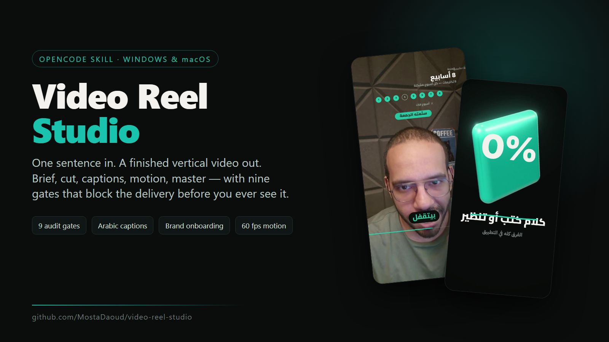
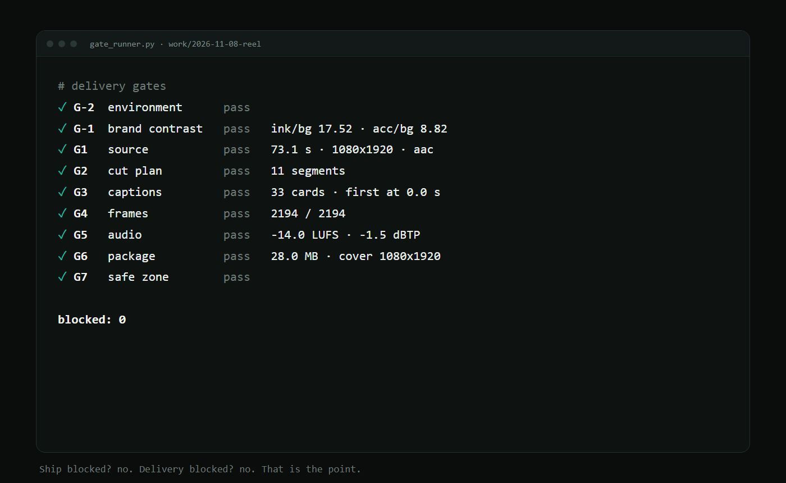

<p align="center">
  
</p>

# Video Reel Studio

**One sentence in. A finished vertical video out — and it refuses to hand it over while a gate is red.**

An OpenCode skill that orchestrates a complete short-form video pipeline: brief → cut → Arabic captions → motion graphics → master → cover → thumbnails. It does not draw a single frame itself; it drives the five production skills underneath it and **audits the result at nine checkpoints** before the file reaches you.

`Windows` · `macOS` · `Linux` · `Arabic-first` · `no cloud` · `MIT`

---

## Why this exists

Every video tool can produce *a* file. Almost none can tell you whether the file is fit to publish. This one can:

- **Nine gates, fail-closed.** Missing frames, a caption after the video ends, a clipped headline, a −0.9 dBTP peak, a 62 MB delivery — each one stops the run with evidence and the exact fix.
- **One prompt, no choreography.** You say «منتج الفيديو ده». It writes a brief, picks the mode, runs the pipeline, delegates the Arabic read and the visual read, and comes back with a file and a gate report.
- **Brand once, reused forever.** Optional onboarding captures colours, font, tone, CTA and taboos into a brand file; every later video applies it with one command and a contrast gate.

<p align="center">
  
</p>

---

## What it makes

| | mode | input | output |
|---|---|---|---|
| 🎙️ | `talking-reel` | one talking-head video (any orientation) | vertical reel, word-timed Arabic captions, motion, cover |
| 🎞️ | `montage` | folder of speechless clips + a track | beat-synced 9:16 montage |
| 🎧 | `podcast` | two or more cameras of one session | reels with a written hook, or a 16:9 episode |
| ✨ | `motion` | a script or a topic | 60 fps motion film, 2D and 3D, no camera |
| 📱 | `web-demo` | a URL | real capture inside a phone (flat or 3D) |
| 🖼️ | `cover-only` | a title | reel cover + YouTube thumbnails |

### Watch the samples

| sample | what it proves | file |
|---|---|---|
| **73 s Arabic reel** | captions, motion, 3D beat, cover, 28 MB master | [▶ reel.mp4](assets/video/reel.mp4) |
| **Motion film, no narration** | 60 fps engine + `stage3D` bloom | [▶ motion.mp4](assets/video/motion.mp4) |
| **Web explainer (3D phone)** | capture → device → camera move | [▶ device3d.mp4](assets/video/device3d.mp4) |
| **Web explainer (flat)** | same capture, 2D compositor | [▶ web-demo.mp4](assets/video/web-demo.mp4) |
| **Beat montage** | 120 BPM cut, 9:16 | [▶ montage.mp4](assets/video/montage.mp4) |

Stills: [reel contact sheet](assets/img/reel-sheet.jpg) · [motion](assets/img/motion.jpg) · [3D device](assets/img/device3d.jpg) · [brand card](assets/img/brand-card.svg)

---

## Install

### 1. Prerequisites

| tool | why | install |
|---|---|---|
| Python 3.10+ | all pipeline scripts | `winget install Python.Python.3.12` / `brew install python` |
| FFmpeg + ffprobe | cut, encode, master | `winget install Gyan.FFmpeg` / `brew install ffmpeg` |
| Node 18+ | the renderer, capture, 3D | `winget install OpenJS.NodeJS` / `brew install node` |
| Google Chrome | canvas rendering + covers | `google.com/chrome` |
| Git | the production skills | `winget install Git.Git` / `brew install git` |

### 2. The production skills (required)

This skill orchestrates them; it does not contain them:

```bash
mkdir -p ~/.config/opencode/skills && cd ~/.config/opencode/skills
git clone https://github.com/majedphotos/video-ad-editor tmp
# main skill + the four modes
cp -r tmp/video-ad-editor tmp/montage-video tmp/motion-video tmp/podcast-video tmp/thumbnail-video .
```

> Upstream is MIT. It ships as a Claude plugin; the five folders are the skills themselves and run as-is under OpenCode.

### 3. This skill

```bash
# macOS / Linux
bash install.sh              # project: ./.opencode/skills   |   global: bash install.sh --global

# Windows
powershell -ExecutionPolicy Bypass -File install.ps1
powershell -ExecutionPolicy Bypass -File install.ps1 -Global
```

### 4. Prove the machine

```bash
python  ~/.config/opencode/skills/video-reel-studio/scripts/preflight.py
python3 ~/.config/opencode/skills/video-reel-studio/scripts/preflight.py   # macOS
```

It checks python, ffmpeg, node, bash, Chrome, numpy/scipy, the five sibling skills, the Cairo font, and whether the brand folder is writable — and prints the right install command per OS. **G-2 is that check.**

---

## Use it

Open OpenCode in a project and say any of these:

| you say | what runs |
|---|---|
| «منتج الفيديو ده» · «حوّله لريل» | talking reel |
| «اعمل مونتاج من المقاطع دي» | montage |
| «اعمل ريلات من الحلقة» | podcast |
| «اعمل فيديو موشن من النص ده» | motion film |
| «اشرح الموقع ده بفيديو» | web/app demo |
| «اعمل كوفر» · «ثمبنيل يوتيوب» | cover / thumbnails |

First run, it asks one question:

> «قبل ما نبدأ: نجهّز هويتك مرة واحدة (5 دقايق: ألوان، خط، نبرة، ممنوعات)،
> ولا نمشي على هوية محفوظة، ولا نكمّل بالافتراضي ونغيّر بعدين؟»

Answer, and it never asks again in that project.

### The loop it runs

```
brief.json → source → cut + transcribe + corrected captions → design → render
          → encode → master → cover + thumbnails → gates → report
```

Every phase has a gate. If one fails: **one targeted fix, re-check that gate only, log it.** Two attempts, then it stops and asks you with evidence instead of guessing.

---

## The nine gates

| gate | checks | blocks |
|---|---|---|
| **G-2** environment | python, ffmpeg, node, bash, Chrome, fonts, sibling skills | yes |
| **G-1** brand | `ink/bg ≥ 4.5`, `acc/bg ≥ 3`, `onAcc/acc ≥ 4.5`, `mut/bg ≥ 3`, font + caption style | yes |
| **G1** source | readable video + audio, duration > 1 s | yes |
| **G2** cut | segments exist, cut file duration matches | yes |
| **G3** captions | first card ≤ 1.2 s, no empty cards, last card inside the video, ≤ 8 s, ≤ 9 words | yes / warn |
| **G4** frames | rendered frames = duration × 30 (±2) | yes |
| **G5** audio | −15.5…−13 LUFS, true peak ≤ −1.0 dBTP | warn / yes |
| **G6** package | ≤ 29 MB, cover 1080×1920, grid + phone preview, `.srt` present | yes / warn |
| **G7** safe zone | no text under Instagram's chrome (runs the renderer twice and diffs) | yes |

```bash
python scripts/gate_runner.py "<work>" --safe   # writes gates.json + gates.md, exit 1 on any blocker
```

Human-judgement gates sit on top of these, delegated to a **fresh-context agent** because the author is the worst judge of their own frames: an Arabic caption read, and a visual read of one contact sheet.

---

## Brand onboarding

```bash
python scripts/onboard.py list
python scripts/onboard.py new acme --name "Acme" --handle "@acme" \
  --audience "founders in MENA" --tone "dry expert" --cta "the workshop" \
  --avoid "hype, neon" --bg "#0B0C0C" --ink "#F4F2EE" --acc "#19C3AE"
python scripts/onboard.py card acme      # SVG identity card
python scripts/onboard.py apply "<work>" acme
```

Stored once at `~/.config/opencode/brands/<slug>.json`; `apply` writes `theme.json` + `brand.md` into the project so it stays portable. Bad contrast is refused at save time — not discovered at render time.

---

## How it is built

```
skill/video-reel-studio/
  SKILL.md                 the orchestrator: contract, phases, gates, non-negotiables
  references/
    pipeline.md            exact commands per phase, per mode, per OS
    gates.md               every gate, threshold, and the fix loop
    roles.md               six roles, when to delegate, delegation prompt
    onboarding.md           the seven brand questions
  scripts/
    preflight.py           environment check (G-2)
    gate_runner.py         the nine gates (G-1 … G7)
    onboard.py             brand list/new/apply/check/card
  assets/brief.template.json
install.sh · install.ps1
```

**Design rule:** deterministic work lives in scripts, judgement lives in instructions, and the two meet only at a gate.

---

## Limits, honestly

- The gates catch **mechanical** defects. "Is this hook strong" is not a gate; it is delegated or asked.
- `podcast` needs two real cameras. `montage` needs 10–20 clips. `web-demo` needs a URL. The skill will say so instead of faking it.
- Generated b-roll and avatars need a `FAL_KEY`; that path is documented upstream, not bundled.
- The 3D path needs a working headless WebGL; on some machines `GL=gpu` is required and SwiftShader is the fallback.
- Arabic transcription on Gulf dialect and English product names still needs a human pass — that is why G3b exists.

---

## Credits & license

MIT © 2026 Mostafa Daoud.

Built on top of [`majedphotos/video-ad-editor`](https://github.com/majedphotos/video-ad-editor) (MIT) and its four sibling skills — the cutter, the caption engine, the motion engine and the renderer are theirs. This repository adds the orchestrator, the gate system, the brand layer, and the cross-platform packaging.

If you use it, the thing to keep is the refusal: **no green gates, no delivery.**
